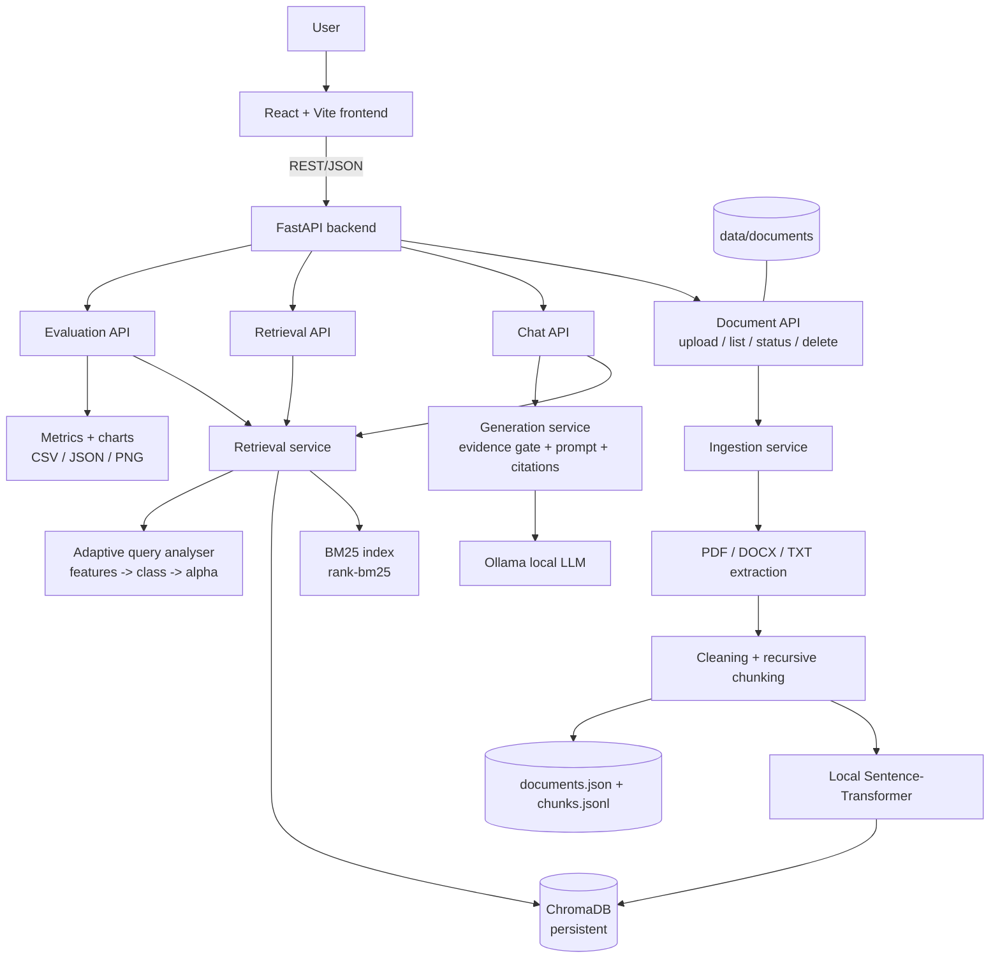
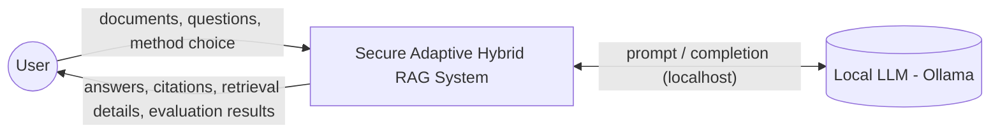
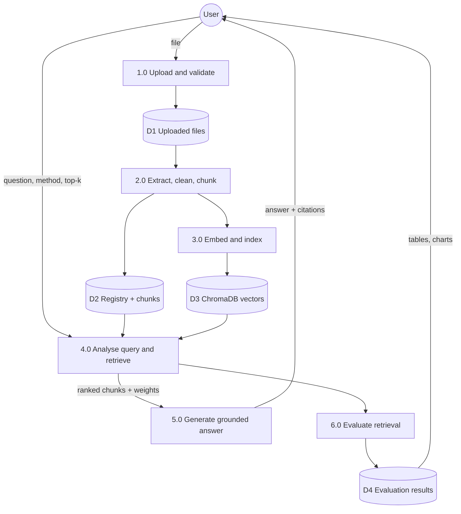
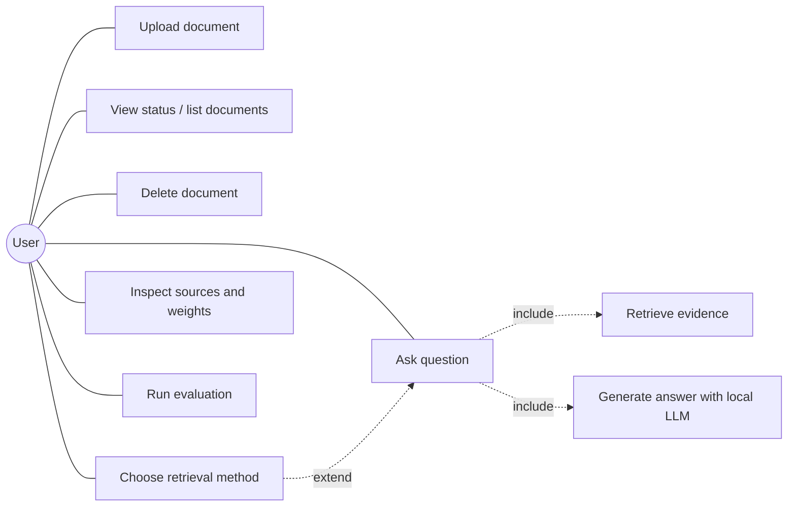
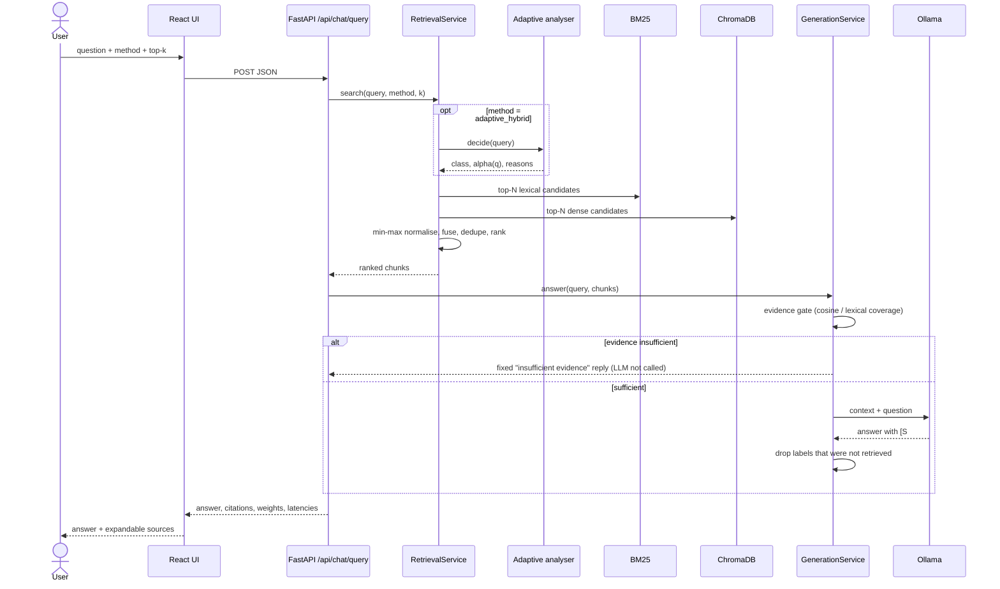

# Architecture

Diagrams are written in Mermaid (render in GitHub, VS Code with a Mermaid extension, or https://mermaid.live) so they can be exported as images for the Review 2 PPT.

## 1. System architecture

## 2. DFD Level 0

## 3. DFD Level 1

## 4. UML use-case diagram

## 5. Sequence: query processing

## 6. Module map

| Module | File |
|---|---|
| Config | `backend/app/core/config.py` |
| Wiring (future auth / RBAC / audit hook point) | `backend/app/core/container.py` |
| Upload API | `backend/app/api/routes/documents.py` |
| Extraction + ingestion | `services/ingestion_service.py` |
| Chunking | `services/chunking_service.py` |
| Embeddings / vector store | `services/embedding_service.py`, `services/vector_service.py` |
| BM25 | `services/bm25_service.py` |
| Fixed + adaptive orchestration | `services/hybrid_retrieval_service.py` |
| Query analysis (core research) | `services/adaptive_retrieval_service.py` |
| Fusion / normalisation | `utils/scoring.py` |
| Generation | `services/generation_service.py` |
| Evaluation | `services/evaluation_service.py`, `experiments/` |

Extension points: every route obtains services from `get_container()`, so authentication, RBAC and permission-aware retrieval can be added as a dependency on the routes and a filter inside `RetrievalService.search` (chunk metadata already carries `document_id`).
